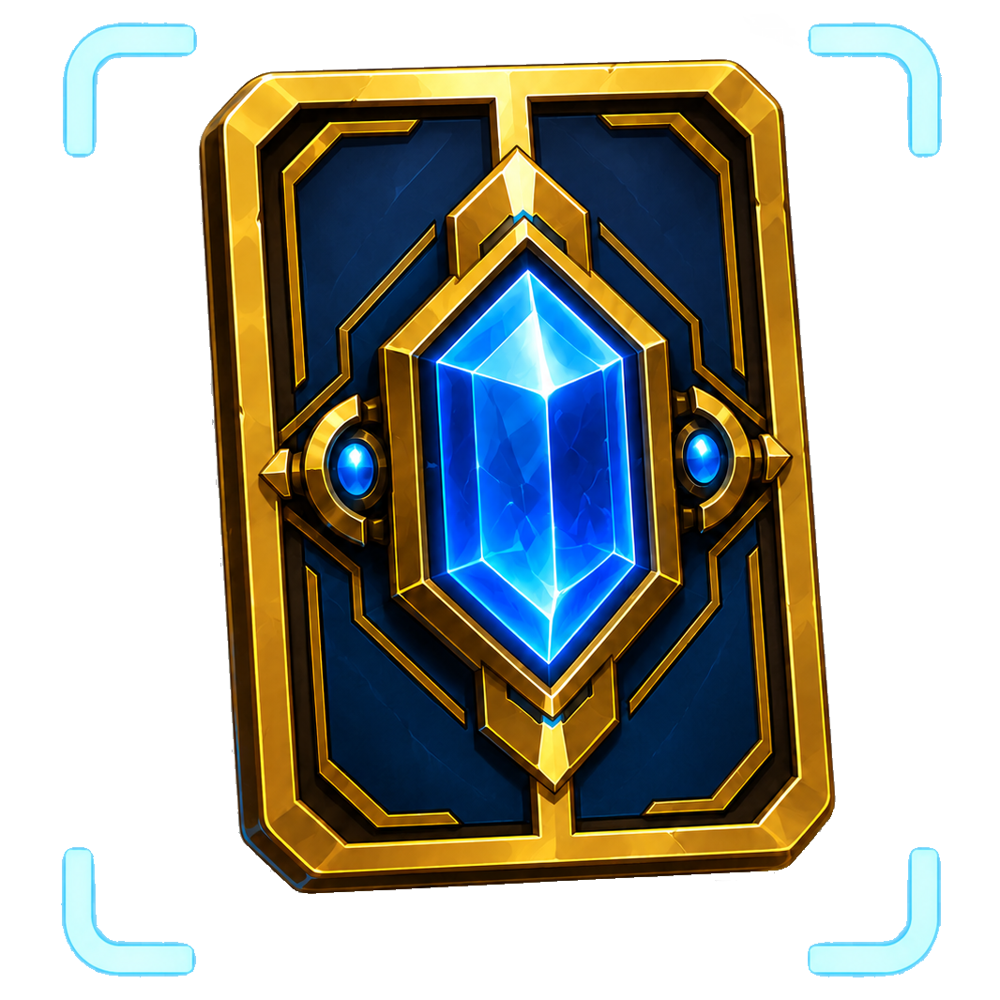
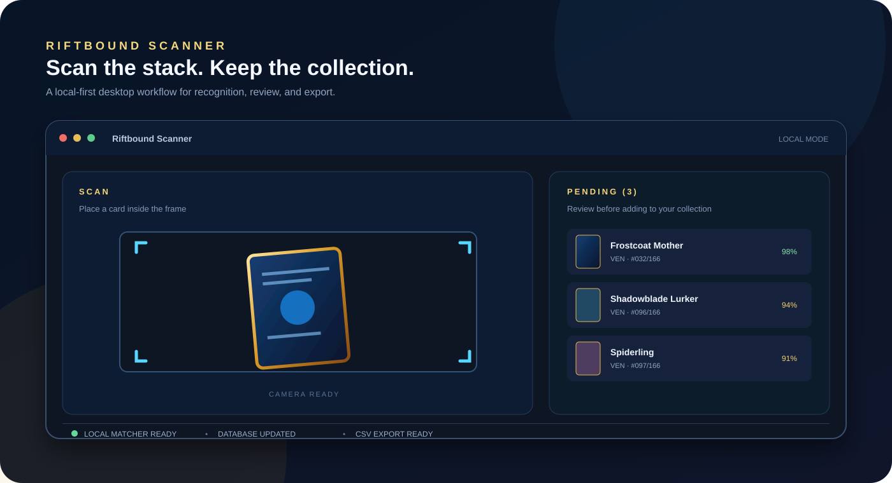
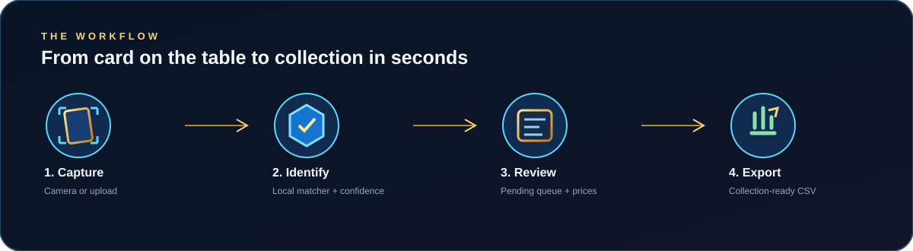

# Riftbound Scanner

  

  <h2>Scan your cards. Build your collection.</h2>

  

    A local-first Windows desktop app for recognizing Riftbound cards,
    reviewing your pulls, tracking prices, and exporting a collection you can actually use.
  

  

    <a href="https://github.com/Teme1999/Riftbound-Card-Scanner/releases/latest"><strong>Download the latest Windows release</strong></a>
    -
    <a href="https://github.com/Teme1999/Riftbound-Card-Scanner/issues">Report an issue</a>
  

## Turn a pile of cards into a collection

Riftbound Scanner is built for the moment after opening packs: point a camera at a card, confirm the match, and keep moving. Recognition, matching, collection data, and the local price cache stay on your machine.

It is designed to feel less like a spreadsheet and more like a dedicated collection companion:

- Scan cards from a webcam or upload a photo of a whole spread.
- Review detections in a pending queue before they enter your collection.
- See confidence, set information, card details, variants, and cached prices together.
- Edit quantity, condition, language, foil, and promo status.
- Export a clean CSV for the workflow or marketplace of your choice.
- Refresh card data from inside the app when a new set arrives.

## How it works

### 1. Capture

Use the camera for rapid scanning, or drop in a larger photo when you are sorting a stack.

### 2. Identify

The bundled detector finds card-shaped regions, then the local matcher compares the artwork against the card database.

### 3. Review

Every result can be checked in the pending queue before it affects your collection. Adjust duplicates and variants as you go.

### 4. Export

Move confirmed cards into your collection and export them as CSV when you are ready.

## Why collectors keep it open

| Feature | What it feels like |
| --- | --- |
| Camera scanning | Scan cards continuously without typing names |
| Photo import | Process a table spread or binder page in one pass |
| Pending review | Keep uncertain matches out of the final collection |
| Local matching | Recognition works on-device after the app is installed |
| Collection tools | Quantities, foil, promo, condition, and language in one place |
| Price snapshots | Optional community price data with selectable display currency |
| Card updates | Add missing cards, including later reveals within sets you already have |
| CSV export | Take your collection into the rest of your workflow |

## Made to stay local

The desktop app runs card detection, card matching, collection storage, and price-cache storage locally. There is no account or cloud collection required.

Network access is limited to explicit update actions:

- Card database updates fetch the Riot card gallery when you request them.
- Price updates fetch the community <code>cards.csv</code> snapshot and ECB exchange rates.
- App update checks and downloads use the signed GitHub Release updater feed.

Price data is a useful snapshot, not a promise of a live sale price. Always verify important trades independently.

The current price source is TCGPlayer through a community CSV snapshot. EUR display is a currency conversion of that USD source. Matching requires the same set and collector identifier; champion subtitles and printing labels are normalized only inside that identity. Conflicting prices stay unpriced, and missing prices display **No price**. Foil, language and condition are not priced independently by this source. Settings shows the source snapshot date separately from the time you imported it.

### Where your data lives on Windows

Downloaded card images are in `%LOCALAPPDATA%\Teme1999\RiftboundScanner\data\cards`. Collection rows, pending cards and settings are stored in the WebView profile's localStorage; matcher metadata/vectors and prices use IndexedDB in that same profile, under `%LOCALAPPDATA%\com.teme1999.riftboundscanner\EBWebView`. **Settings → Stored data** shows the resolved folders and can open them.

AppData remains the default for writable user data. The installation contains the app and bundled assets. Keeping these separate avoids installation-folder permissions and lets app updates replace binaries without relocating the user's profile. Collection CSV export is a readable copy, not a complete backup of every app database. Portable storage would need an explicit mode and migration; moving the existing WebView profile by hand is not supported.

## Download

The supported runtime is the Windows desktop app. Download the latest <code>.msi</code> installer from the [GitHub Releases page](https://github.com/Teme1999/Riftbound-Card-Scanner/releases/latest).

Windows may show a SmartScreen or "unknown publisher" warning because releases are not currently signed with a commercial Windows certificate.

## Keep it current

After installing:

1. Open **Settings**.
2. Use **Update Card Database** when a new set is available.
3. Use **Update Price Data** when you want a fresh community price snapshot.
4. Pick your display currency and continue scanning.

The updater compares individual card IDs with the Riot gallery and downloads missing cards, including cards published after you first imported a set. Failed downloads are retried the next time you run the update. Existing card records and your collection are retained.

On startup, newer bundled cards also supplement an imported database with the same feature grid. Existing local card records and cached image paths take precedence. A missing bundle or local storage failure does not prevent using an already loaded database.

Pending and collection rows keep separate quantities for each finish, promo status, condition, and language. Reviewing a row updates the same data used by individual adds, bulk adds, and CSV exports. Older local collection saves acquire stable row IDs automatically when loaded.

## Scanning in difficult conditions

Camera capture now follows the visible scanning frame, including the cropping used by the preview. The detector leaves context around this region and retries its input scale when necessary so close cards remain within its expected size range. Keep one card inside that frame. The scanner samples a short buffer of up to three recent frames and prefers clearer images; movement or a layout change discards older images. Buffered copies of the same video frame do not count as independent confirmations. Slow cameras can supply distinct confirmations at their own frame rate; a long capture interruption clears unfinished confirmation evidence.

Detected crops are normalized to portrait orientation before matching. This handles equivalent rotated-box axes that otherwise leave an upright card sideways. It does not determine whether a card is upside down.

Artwork matching combines color similarity with a comparison of the spatial light/dark pattern in each color channel. This reduces ambiguous matches between different cards with similar colors. Camera and uploaded-photo review share this ranking. Development debug shows candidates and verification evidence; unaccepted candidates are labeled explicitly. Matching scores are heuristics, not probabilities of correctness. See the [recognition pipeline](docs/scanner-experiments.md).

- Read the on-screen guidance for severe darkness, blur, small cards, movement, or an unclear match. Reflection advice is shown alongside an ambiguous match because bright artwork can resemble glare.
- Open **Settings → Camera Input → Capture profile** to choose Automatic (prefer 1080p), Balanced (prefer 720p), or Low light (prefer 720p at 15 fps). Profiles are saved separately for each selected camera. Requested formats are preferences; the current input readout shows what the camera actually provides.
- Supported cameras use continuous autofocus, automatic exposure, and automatic white balance. Unsupported controls are skipped independently. The low-light profile gives the camera more opportunity to use a longer exposure, which also makes holding the card still more important.
- Auto-scan requires fresh reliable observations and usable card detail. It selects between separated artwork and independently text-verified artwork using the rules below; repetition alone never confirms an unclear card.
- **Settings → Scan Sound** controls a short chime for camera scans accepted into the pending list. It defaults to ON at 35% volume; toggle it, adjust the volume, or use **Play test sound**. Preferences are saved on this device. Rejected/duplicate observations and manual collection edits do not chime. Audio is generated locally and unlocked by an app interaction; unavailable or muted audio does not affect scanning.

Perspective correction and English name/collector verification are enabled by default, including profiles saved with the earlier opt-in defaults. Up to four supported card-edge quadrilaterals are compared with the original crop. Uncertain geometry keeps the original; conflicting strong interpretations require text verification or manual review.

Acceptance is automatic. A fast visual path checks artwork keypoints and their projective geometry in two fresh camera frames; a strong, unique identity can qualify without waiting for OCR. Shared frames, cost symbols and other card graphics are excluded from that verification. All known printings with the same name or near-identical reference artwork are compared, including sets hidden by a filter. Different illustrations can qualify visually; indistinguishable printings still require text verification. Two independently read names and full collector codes can resolve a difficult view when the same card has supporting artwork details. Poor quality and trusted contradictions block automatic acceptance. Scores and actual candidate margins stay unchanged; there is no user similarity slider. An uncertain manual tap still offers explicit candidate review.

**Scan overlay** shows the tracked card outline, reference thumbnail, name and verification status. It starts enabled and remembers your preference. Toggle it in the camera view to hide this feedback; auto-scan remains a separate control. Candidate previews are informational and do not mean that a card has been accepted. The preview clears when tracking is lost or the last observation expires. This display does not save images or video.

Runes with unique illustrations, including alternate art, can use the same two-frame visual verification after all known printings have been compared. Artwork shared between sets requires two different camera frames that each provide a complete rune name and printed set code at OCR confidence 90 or higher, with geometry separating that set's printing from its alternate art. The set filter never supplies a missing set code. If multiple printings within the read set remain ambiguous, the full collector code is still required.

Smooth or reflective rune artwork can additionally use aligned pixel comparisons across several illustration regions, with separation from alternate printings. The illustration alignment can straighten the actual camera pixels for OCR; the title, type strip and footer are excluded from the artwork comparison. Resampling never increases the measured native text resolution. If an imported reference image has disappeared from disk, the visual worker tries the bundled image for that same card ID. Missing both references blocks verification and exposes the reference error in debug.

Borderless cards also have a guarded detector fallback: a lower-confidence box can only qualify through independent geometry or text evidence, never coarse artwork similarity alone. Poor or ambiguous views remain unaccepted.

Debug overlays, native-frame exports and session recording are development-only tools. Release builds ignore stored debug preferences, omit those controls and exclude the native diagnostic commands. The release app does not automatically save camera images or video. Developer instructions and measured limitations are in [scanner experiments](docs/scanner-experiments.md).

Quality thresholds are conservative heuristics sampled at a fixed resolution. Glare and uneven shadows can still cause missed matches. Automated checks and synthetic images do not establish accuracy, frame rate, or camera compatibility in real use; evaluate those on held-out camera sessions before making accuracy claims.

## Independent fan project

Riftbound Scanner is maintained by Teme1999. It is unofficial and is not affiliated with, endorsed by, sponsored by, or connected to Riot Games or the upstream project maintainer.

Riftbound, League of Legends, and related marks belong to their respective owners. See [NOTICE.md](NOTICE.md) for legal, trademark, and upstream attribution details.

## For developers

Build, run, contribute, and release the app

### Repository layout

~~~text
riftbound-scanner/
|-- src/                 # React UI, scanner hooks, matcher, runtime helpers
|-- public/              # App images plus generated runtime assets
|-- model/               # Scraper, synthetic data generator, training scripts
|-- scripts/             # Build and release checks
+-- src-tauri/           # Tauri desktop shell
~~~

### Prerequisites

- Node.js 18 or newer
- npm
- Rust 1.77.2 or newer
- Python 3.10+ for asset generation and detector retraining
- Optional: CUDA-capable GPU for faster training

### Install and run

~~~bash
npm install
npm run desktop:dev
~~~

Python dependencies are only needed for scraping, dataset generation, and training:

~~~bash
cd model
python -m pip install -r requirements.txt
~~~

### Build checks

~~~bash
npm run check
npm audit --omit=dev --audit-level=moderate
npm run desktop:build
~~~

`npm test` runs frontend regression tests for review, variants, persistence compatibility, exports, and auto-scan acceptance. `npm run desktop:test` covers later card reveals and retrying incomplete gallery updates. `npm run check` runs both test suites, builds the UI with runtime-asset checks, and checks the Rust code. Building the UI first ensures the desktop checks can embed the current assets even on a fresh checkout. These checks do not measure real-camera recognition accuracy.

Production builds require these generated assets:

- <code>public/card-hashes.json</code>
- <code>public/cards/*.webp</code>
- <code>public/models/yolo11n-obb-riftbound.onnx</code>
- <code>public/models/yolo11n-obb-riftbound-q8.onnx</code>

Run <code>npm run check:assets</code> to verify them. Generate card metadata and matcher assets with:

~~~bash
cd model
python cards_scraper.py
~~~

The scraper updates images incrementally, retries failed downloads, and replaces images and the generated matcher file atomically. Existing images remain available during a failed update. It also refreshes images whose gallery URL changed. A nonzero exit status reports incomplete downloads; rerun to retry them.

After refreshing assets, run `npm run test:cards` to check image/feature completeness and minimum set coverage (including Radiance and Vendetta). Run `python -m unittest discover -s tests -p test_cards_scraper.py` from the repository root using the model environment for incremental-download regression tests. To exercise actual browser canvas matching and the quantized ONNX detector, start the Vite development server and open `/tests/fixtures/card-validation.html`, then select **Run scanner checks**. The report covers all clean reference images, six degraded-image scenarios for Radiance/Vendetta, and 72 detector inputs from 24 cards. Ambiguous and rejected results are counted separately from wrong accepted results. This synthetic regression does not substitute for held-out camera photos.

See [the 2026-10-26 validation snapshot](docs/scanner-validation-2026-10-26.md) for card coverage, the crop-orientation regression, measured synthetic results, and remaining detection limitations.

### Contributing

Contributions are welcome around scanner accuracy, card data cleanup, collection/export workflows, UI polish, Windows reliability, model training, documentation, and testing.

Use focused branches such as <code>feature/card-search-filters</code> or <code>fix/camera-restart-loop</code>. Open pull requests into <code>develop</code>; releases are cut from <code>main</code>.

### Releases

The release workflow at <code>.github/workflows/release.yml</code> builds the Windows MSI, signs updater artifacts, publishes <code>latest.json</code>, and creates the GitHub Release. Runtime assets are distributed separately because generated card images, models, and hashes are not tracked in git.

The updater signing private key must remain outside the repository. See the workflow and release configuration before preparing a signed build.

See [2026.10.30.1 release notes](docs/release-2026.10.30.1.md) for the scanner changes and pre-release checks. Development captures and model-comparison tools are excluded from release builds.

Release packaging uses GitHub-safe artifact names and validates manifest URLs, version agreement and signature sidecars before publishing. Calendar labels such as `2026.10.26.2` use numeric app/MSI versions such as `26.10.2602` (day × 100 + daily index in the third component), so same-day releases increase the three fields compared by Windows Installer. App updates download first, stop capture, flush the latest collection/settings state, and then install; Windows can exit the process during installation. Update controls remain accessible when scanner initialization fails.

See [the maintenance audit](docs/maintenance-audit-2026-10-26.md) for the published feed defect, current price coverage, Cardmarket data availability, storage decisions and validation limits.

## License

This project is distributed under the MIT License. See [LICENSE](LICENSE).
